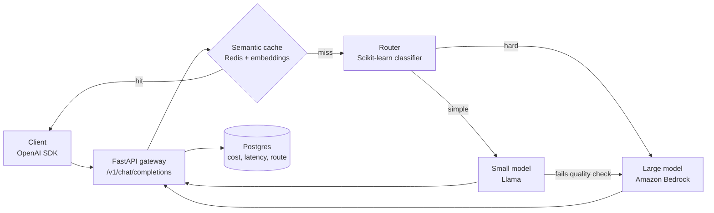

# Cost-aware LLM Gateway

> **Status: in active development.** v0.1 target: 26 Oct 2026. The roadmap below tracks progress.

An OpenAI-compatible API gateway that sends each prompt to the **cheapest model that can answer it well**.
A Scikit-learn classifier decides whether a prompt is simple or hard: simple prompts go to a small Llama model, hard ones to a large LLM.
Repeated questions are served from a semantic cache, and every request is logged with its cost, latency and routing decision.

## Why

Most production LLM traffic is simple: lookups, rewrites, short classifications. Sending all of it to a frontier model wastes money and adds latency.
This gateway puts a small, measurable routing decision in front of the models, so you can see exactly what quality you trade for each rupee saved.

## Architecture

## Features

- **OpenAI-compatible endpoint:** works with any client that speaks the OpenAI Chat Completions API.
- **Learned router:** a Scikit-learn text classifier trained on a Pandas-labelled set of easy and hard prompts.
- **Fallback:** escalates to the large model when the small model's answer fails a check.
- **Semantic cache:** answers a repeated question by meaning, not exact text, using embeddings in Redis.
- **Cost and latency tracing:** per-request logs, plus a `/stats` endpoint.
- **API keys and rate limiting** per client.

## Tech stack

Python · FastAPI · Pandas · Scikit-learn · Llama (Ollama locally, Amazon Bedrock in the cloud) · Amazon Bedrock · Redis · PostgreSQL · Docker Compose · pytest · GitHub Actions

## Benchmark

About 300 prompts run three ways (always-large, always-small, routed), with answer quality scored by an LLM-as-judge.

| Setup | Cost per 1K requests | Quality score | p95 latency |
|---|---|---|---|
| Always large model | TBD | TBD | TBD |
| Always small model | TBD | TBD | TBD |
| **Routed** | TBD | TBD | TBD |

*Results will be published here when the benchmark runs.*

## Roadmap

- [ ] FastAPI gateway with OpenAI-compatible endpoint
- [ ] Llama (Ollama) and Amazon Bedrock clients
- [ ] Request logging to PostgreSQL
- [ ] Labelled prompt dataset and Scikit-learn router
- [ ] Quality-check fallback
- [ ] Redis semantic cache
- [ ] `/stats` endpoint and tracing
- [ ] Benchmark script and results
- [ ] pytest suite and GitHub Actions CI
- [ ] Docker Compose one-command setup

## Quick start

*Coming with v0.1:* `docker compose up`

## License

MIT
