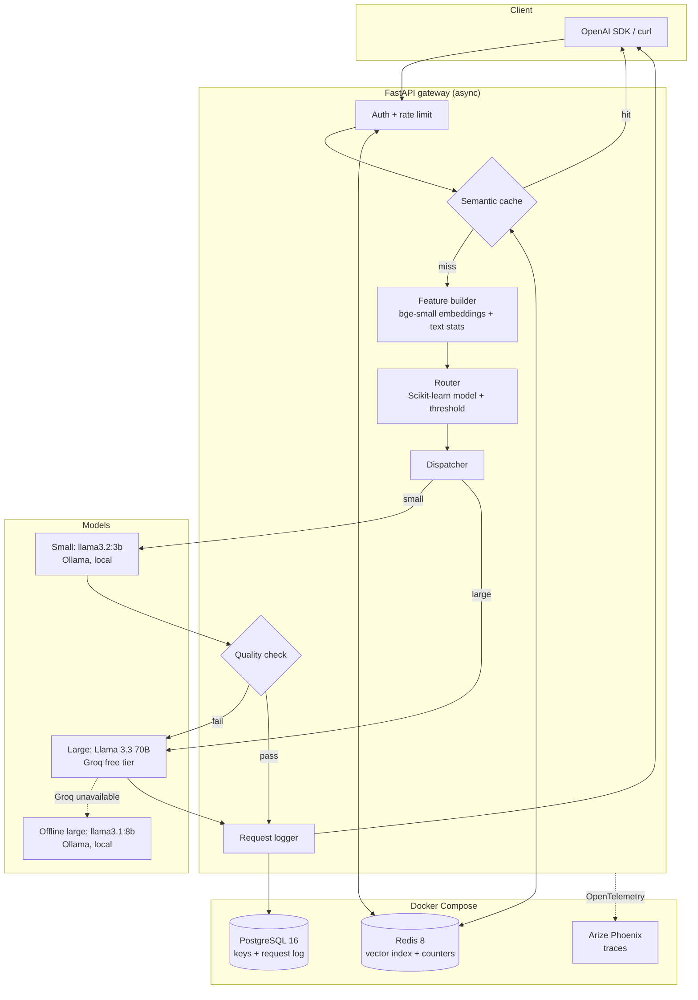

# Cost-aware LLM Gateway: Architecture and Design

*Status: design final, ready for implementation planning. Date: 19 Oct 2026. Author: Aryan Kansal.*

## 1. Intent

An OpenAI-compatible HTTP gateway that sits in front of language models and, for every request, picks the **cheapest model that will answer well enough**.
A trained classifier predicts whether a small local model can handle a prompt. If it can, the request goes there; if not, it goes to a large model.
Repeated questions are answered from a semantic cache. Every request is logged with its route, latency, token counts and estimated cost.

The project is a portfolio piece. It must prove three things to a hiring panel:
1. Practical LLM engineering: routing, caching, fallbacks, observability.
2. Classic ML done properly: a labelled dataset, a Scikit-learn model, held-out evaluation, and threshold tuning against a business target.
3. Honest measurement: a reproducible benchmark with real numbers.

## 2. Goals, non-goals, anti-goals

**Goals**
- `POST /v1/chat/completions` works unchanged with the official OpenAI Python SDK (`base_url` swap only).
- A router trained on real labelled data, with ROC-AUC, precision and recall reported on a held-out split.
- A benchmark comparing always-small, always-large and routed setups on quality, cost and p95 latency.
- One-command local setup (`docker compose up`), with tests and lint passing in GitHub Actions.

**Non-goals**
- Streaming responses in v0.1. This is a stretch goal; the API returns `400` when `stream: true` is sent.
- Tool or function calling, image inputs, embeddings endpoint.
- Multi-tenant billing, admin UI, horizontal scaling.

**Anti-goals** (failures even if the code works)
- **Any paid service or a credit card on file.** Every component is open source or a no-card free tier.
- **Invented or unreproducible numbers.** Every figure in the README must come from a script in this repo that anyone can re-run.
- **Hiding the gateway logic behind a library.** No LiteLLM or similar: the routing, cache and fallback code is the point of the project.

## 3. Constraints

| Constraint | Effect on design |
|---|---|
| **Free only** | Small and fallback models run locally on Ollama. The large model and the judge use **Groq's free tier** (no card required). Everything else is open source in Docker. |
| **Laptop: RTX 3050 6 GB, 16 GB RAM** | Small model is a 3B model (~2 GB VRAM). A local 8B model (~5 GB) is the offline "large" fallback; the two are never loaded together. |
| **Free-tier rate limits** | Every model call made by scripts (labelling, benchmark, judge) is cached on disk, so a re-run costs zero API calls. The dataset size is chosen to fit daily limits. |
| **~3 days of build time** | Plain SQL schema instead of a migrations framework. Synchronous scripts for the offline ML work; only the gateway itself is async. |
| **Must match the resume** | OpenAI-compatible API, small Llama model, Scikit-learn classifier on Pandas-labelled data, embeddings-based semantic cache, cost and latency tracing, LLM-as-judge benchmark with p95 latency, pytest, GitHub Actions CI/CD. |

## 4. System overview



## 5. Component decisions

Each decision lists what was chosen, the free alternative considered, and why.

### 5.1 Model access: one client, three backends
- **Choice:** the official `openai` Python SDK (`AsyncOpenAI`) pointed at different `base_url`s. Ollama (running on the host for GPU access; reached from containers at `http://host.docker.internal:11434/v1`) and Groq (`https://api.groq.com/openai/v1`) both expose OpenAI-compatible endpoints.
- **Why:** one code path, no provider-specific SDKs, and the gateway's own interface mirrors what it calls.
- **Model tiers** (all names are config values in `config/models.yaml`, not hard-coded):
  - `small`: `llama3.2:3b` on Ollama.
  - `large`: `llama-3.3-70b-versatile` on Groq. *Before building, confirm this model is still on Groq's free tier in the Groq console; swap the config value if not.*
  - `large_offline`: `llama3.1:8b` on Ollama, used automatically when Groq returns 429 or 5xx, or when no `GROQ_API_KEY` is set.

### 5.2 Router: Scikit-learn classifier
- **Target label:** `small_ok = 1` if the small model's answer is judged **at least as good** as the large model's answer for that prompt (a tie counts as 1).
- **Features:** a 384-dimension `BAAI/bge-small-en-v1.5` embedding of the last user message, plus handcrafted features: token count, number of questions, has a code block, has maths symbols or digits ratio, presence of words like "prove", "step by step", "compare", and the number of conversation turns.
- **Models compared:** `LogisticRegression` (with class weights) and `HistGradientBoostingClassifier`. Pick by ROC-AUC on the validation split, then wrap the winner in `CalibratedClassifierCV` so its scores behave like probabilities.
- **Threshold:** route small when `P(small_ok) ≥ t`. Choose `t` on the validation split as the **lowest threshold whose routed quality stays ≥ 95% of always-large quality**. Plot the full cost-versus-quality curve in the README.
- **Artifact:** `models/router-v1.joblib` (a few MB) is committed to the repo with a `router-v1.json` model card: training date, dataset hash, metrics and threshold.
- **Why not an LLM as router:** it adds latency and cost to every request; the whole point is that routing is nearly free.

### 5.3 Labelled dataset (the ML pipeline)
- **Sources** (all openly licensed, loaded with Hugging Face `datasets`): `databricks-dolly-15k` (simple instructions), `gsm8k` (maths), `cais/mmlu` (knowledge), `openai_humaneval` (code) and `lmsys/mt_bench_human_judgments` prompts (open-ended). Sample **600 prompts**, stratified by source.
- **Labelling script** (`scripts/label.py`):
  1. Run every prompt through the small and large models.
  2. Ask the judge to compare the two answers pairwise, **in both orders** to cancel position bias, and output `A`, `B` or `tie`.
  3. Write `data/labels.parquet` with prompt, source, both answers, both verdicts, the final label and token counts.
- **Judge model:** a Groq free-tier model **from a different family** than the large model (e.g. a Qwen or GPT-OSS model on Groq) to reduce self-preference bias. Configured in `config/models.yaml`.
- **Split:** 70 / 15 / 15 train / validation / test, stratified by source and label. The test split is used **only** by the final benchmark.
- **Caching:** every model call is keyed by `sha256(model + messages + params)` and stored in `data/cache.sqlite`, so labelling can be spread over several days of free-tier quota and re-runs are free.

### 5.4 Semantic cache
- **Store:** Redis 8 (open source, includes the Query Engine with HNSW vector search). Index on a 384-dimension cosine vector.
- **Key:** embedding of the normalised last user message. A hit also requires an exact match on a hash of the system prompt and the generation parameters.
- **When to cache:** only single-turn requests with `temperature ≤ 0.3`. Multi-turn or creative requests bypass the cache, so stale context can never leak into an answer.
- **Hit rule:** cosine similarity ≥ `0.95` (config value). Entries expire after 24 h.
- **Why Redis rather than pgvector:** the cache is hot-path, latency-sensitive and disposable; Postgres holds durable records. Redis also does the rate-limit counters, so it is not an extra component.

### 5.5 Fallback quality check
Cheap, deterministic checks on the small model's answer; any failure re-sends the request to the large tier and marks `fallback = true` in the log:
- empty or whitespace-only answer
- `finish_reason == "length"` (truncated)
- refusal phrases ("I can't", "as an AI") when the router was confident
- invalid JSON when the request asked for `response_format: json_object`

An LLM-based verifier is deliberately excluded: it would cost as much as calling the large model in the first place.

### 5.6 Cost model
All models in this project are free, so actual spend is always $0. To show what routing **would** save, every request also records a **notional cost** computed from `config/prices.yaml`: a reference per-million-token price for each tier, taken from public list prices of comparable hosted models and dated in the file.
The README reports notional cost and states clearly that it is an estimate based on that price table.

### 5.7 Auth and rate limiting
- API keys are generated by `scripts/create_key.py`, shown once, and stored as `sha256` hashes in Postgres.
- Rate limit: fixed window per key using Redis `INCR` + `EXPIRE` (default 60 requests per minute). Exceeding it returns `429` with a `Retry-After` header.

### 5.8 Storage
PostgreSQL 16, schema created by `sql/init.sql` on first start.

```sql
api_keys(id uuid pk, name text, key_hash text unique, created_at timestamptz, active bool)

request_log(
  id uuid pk, ts timestamptz, api_key_id uuid fk,
  route text,            -- 'cache' | 'small' | 'large' | 'large_offline'
  model text, router_score real, fallback bool, cache_hit bool,
  prompt_tokens int, completion_tokens int,
  latency_ms int, notional_cost_usd numeric(12,8),
  status int, error text
)
```

### 5.9 Observability
- **Traces:** OpenTelemetry using OpenInference instrumentation for the OpenAI SDK, exported to **Arize Phoenix** running self-hosted in Docker. Each request is one trace with spans for cache lookup, routing, model call and fallback.
- **Response headers on every reply:** `x-route`, `x-router-score`, `x-notional-cost-usd`, `x-latency-ms`.
- **`GET /stats`:** aggregates from `request_log` for a time window: requests by route, cache hit rate, fallback rate, p50 and p95 latency, and notional cost against an always-large baseline.

## 6. API

| Method | Path | Notes |
|---|---|---|
| `POST` | `/v1/chat/completions` | OpenAI schema subset: `model`, `messages`, `temperature`, `max_tokens`, `response_format`. `model: "auto"` enables routing; `"small"` or `"large"` forces a tier; any other name returns `400`. |
| `GET` | `/v1/models` | Lists `auto`, `small`, `large`. |
| `GET` | `/stats?window=24h` | Aggregates described in 5.9. |
| `GET` | `/health` | Checks Redis, Postgres and Ollama. |

Errors use the OpenAI error envelope (`{"error": {"message", "type", "code"}}`) so SDK clients handle them normally.

## 7. Benchmark (`scripts/benchmark.py`)

- **Input:** the held-out test split (about 90 prompts), never seen by the router during training or threshold tuning.
- **Setups:** always-small, always-large, routed at the tuned threshold.
- **Metrics per setup:**
  - quality: win/tie rate against always-large, from the same pairwise judge
  - notional cost per 1,000 requests
  - p50 and p95 latency
  - share of traffic sent to the small model
- **Cache experiment:** replay the test prompts plus an LLM-generated paraphrase of each, and report the cache hit rate and the latency saved on hits.
- **Output:** `results/benchmark.md` and `results/cost_quality_curve.png`. These are committed, and the README table is copied from them.

## 8. Repository layout

```
llm-gateway/
├─ app/
│  ├─ main.py            # FastAPI app, routes
│  ├─ schemas.py         # OpenAI-compatible request/response models
│  ├─ providers.py       # AsyncOpenAI clients per tier, offline fallback
│  ├─ router.py          # load joblib, build features, decide
│  ├─ features.py        # embeddings + handcrafted features (shared with training)
│  ├─ cache.py           # Redis vector cache
│  ├─ quality.py         # fallback checks
│  ├─ ratelimit.py, auth.py, costs.py, db.py, telemetry.py, config.py
├─ scripts/  label.py  train_router.py  benchmark.py  create_key.py
├─ config/   models.yaml  prices.yaml
├─ models/   router-v1.joblib  router-v1.json
├─ data/     (gitignored: cache.sqlite, labels.parquet, raw/)
├─ results/  benchmark.md  cost_quality_curve.png
├─ sql/init.sql
├─ tests/    unit/  integration/
├─ docker-compose.yml  Dockerfile  pyproject.toml  .env.example
└─ .github/workflows/ci.yml
```

`features.py` is imported by both the gateway and `train_router.py`, so training and serving can never compute features differently.

## 9. Tech stack (all free)

| Layer | Choice | License / tier |
|---|---|---|
| Language, packaging | Python 3.12, `uv` | open source |
| API | FastAPI, Pydantic v2, Uvicorn | MIT / BSD |
| Model clients | `openai` Python SDK | Apache-2.0 |
| Local models | Ollama: `llama3.2:3b`, `llama3.1:8b` | free; Llama community license |
| Large model and judge | Groq API | free tier, no card |
| Embeddings | `fastembed` with `BAAI/bge-small-en-v1.5` (ONNX, CPU) | Apache-2.0 / MIT |
| ML | Pandas, NumPy, Scikit-learn, joblib, Matplotlib | BSD |
| Datasets | Hugging Face `datasets` | Apache-2.0; dataset licenses per source |
| Cache and counters | Redis 8 | open source (AGPLv3 option) |
| Database | PostgreSQL 16, `asyncpg` | PostgreSQL / Apache-2.0 |
| Tracing | OpenTelemetry, OpenInference, Arize Phoenix | Apache-2.0 / Elastic-2.0 (free self-host) |
| Testing, lint | pytest, pytest-asyncio, respx, ruff | MIT |
| CI | GitHub Actions | free for public repos |
| Containers | Docker Compose | free |

## 10. Testing and CI

- **Unit:** feature builder, router threshold logic, quality checks, cost maths, rate limiter, cache hit/miss rules. Model calls are faked with `respx`.
- **Integration:** gateway endpoints against real Redis and Postgres (GitHub Actions `services:` containers), with Ollama and Groq mocked. One test runs the official OpenAI SDK against the gateway to prove compatibility.
- **CI workflow** (on push and pull request): `ruff check`, `ruff format --check`, `pytest`. A README badge shows the status.
- No real model calls run in CI: they are slow, and they would spend free-tier quota.

## 11. Delivery plan (3 days)

| Day | Outcome |
|---|---|
| 1 | Compose stack (Postgres, Redis, Phoenix; Ollama runs on the host for GPU access), FastAPI endpoint with forced `small`/`large` tiers, request logging, auth, rate limit, CI green |
| 2 | Labelling run (may continue in the background over several days of quota), feature builder, training script, router v1 and model card, semantic cache, fallback checks |
| 3 | Benchmark and results, `/stats`, tracing, README results table and demo GIF |

## 12. Risks

| Risk | Mitigation |
|---|---|
| Groq free-tier limits slow down labelling | Disk cache; 600-prompt dataset; labelling can run over 2–3 days; the judge can be swapped to a local model in config |
| Groq changes which models are free | All model names are config values; offline tier keeps the gateway working |
| Too few `small_ok = 0` examples (router learns nothing) | Stratified sampling includes hard sources (gsm8k, humaneval); check label balance before training and resample if one class is under 25% |
| Judge bias | Pairwise judging in both orders; judge from a different model family; a 30-item manual spot-check recorded in `results/judge_audit.md` |
| 6 GB GPU cannot hold both local models | Ollama loads models on demand; the 8B model is only used when Groq is down |

## 13. Left to the builder

- Exact handcrafted feature list beyond those named in 5.2.
- Prompt wording for the judge (must output only `A`, `B` or `tie`).
- Whether `/stats` also renders a minimal HTML page.
- Log retention and cleanup.

## 14. Decisions made by Claude, for Aryan to review

1. **Groq free tier** for the large model and judge, because no local model that fits a 6 GB GPU is meaningfully "large".
2. **Amazon Bedrock dropped** (no free tier). The resume and README were updated to match.
3. **Notional cost** from a dated price table, because actual spend is always $0.
4. **No LiteLLM**, so the gateway logic is visibly your own code.
5. **Redis for the cache, Postgres for the logs**, instead of putting both in one store.
6. **Arize Phoenix** for tracing instead of self-hosted Langfuse, which needs ClickHouse and object storage and is too heavy for a laptop.
7. **Plain `init.sql`** instead of Alembic migrations, to save build time.
8. **No streaming** in v0.1.
